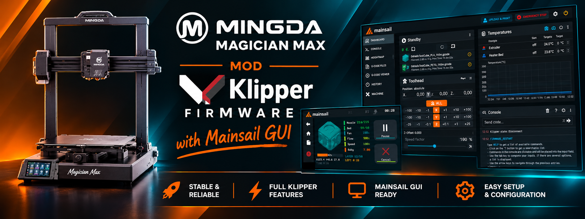

# Klipper for the Mingda Magician Max — with the stock touchscreen

Turn a Mingda Magician Max into a modern Klipper printer **and keep using the
original touchscreen**: a Raspberry Pi runs Klipper and talks to the printer
over a serial cable, and this repository also drives the stock 3.5" screen
(480×320 ST7796) so you get a clean touch GUI on the machine itself.

No experience with Klipper needed — follow the steps in order. Two evenings
max (most of the time is the first controller flash).

**What you end up with**

| | |
|---|---|
| 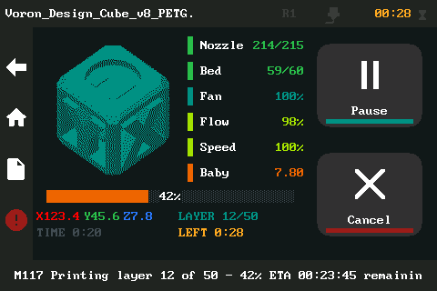<br>**Print** — object preview, position, ENDS time, pause/cancel | 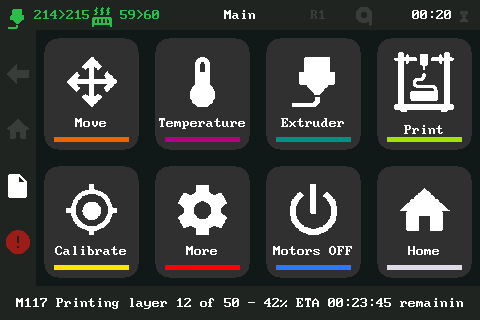<br>**Main** — every screen one tap away |
| 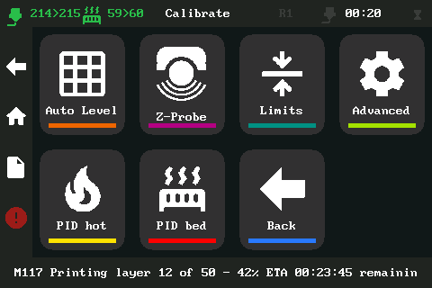<br>**Calibrate** — all the tuning screens in one place | 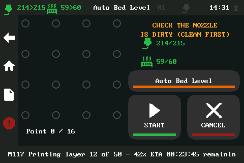<br>**Auto Bed Level** — live probe map |
| 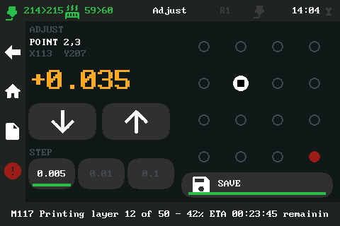<br>**Adjust** — nudge any mesh point, save to the config | 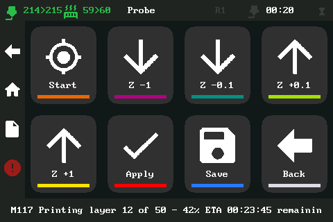<br>**Z-Probe** — 0.005…1 mm steps, start/apply/save/cancel |
| 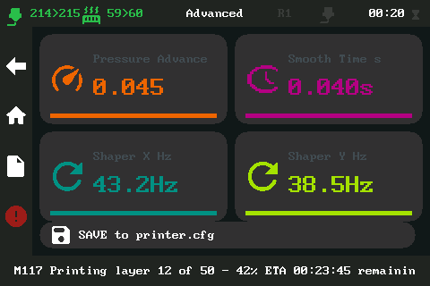<br>**Advanced** — pressure advance, smoothing, input shaper | 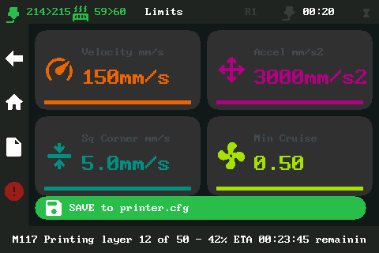<br>**Limits** — speed, acceleration, square corner |
| 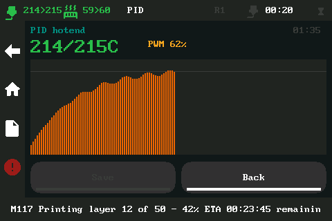<br>**PID** — live temperature graph, save or abort | 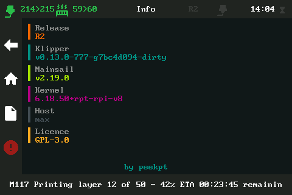<br>**Info** — release, Klipper, Mainsail, kernel, licence |
| 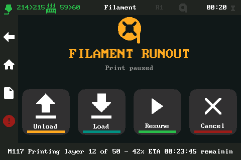<br>**Filament runout** — unload/load, resume, cancel | 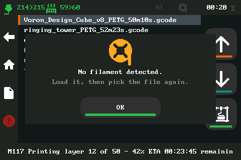<br>**No filament** — warning before a print starts |
| 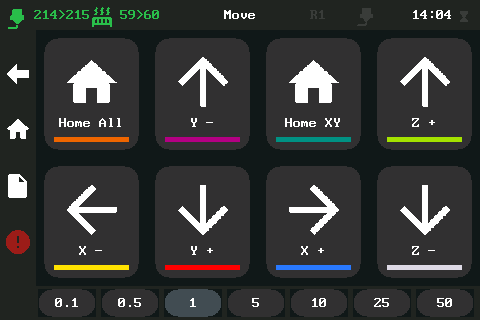<br>**Move** — jog any axis, steps from 0.1 to 50 mm | 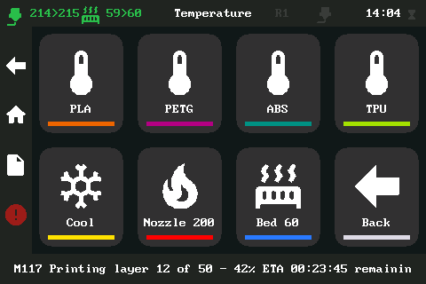<br>**Temperature** — material presets and manual set |
| 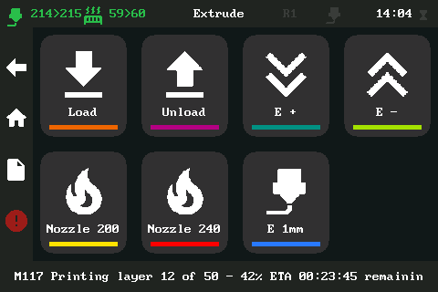<br>**Extruder** — load/unload filament, extrude | 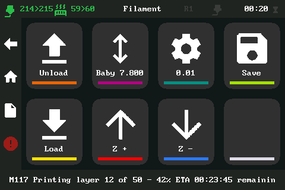<br>**Filament** — eject/insert, live baby stepping |
| 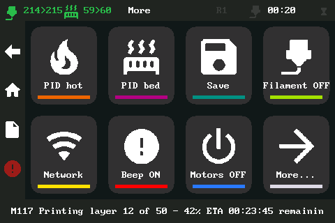<br>**More** — save config, filament sensor, network, beep | 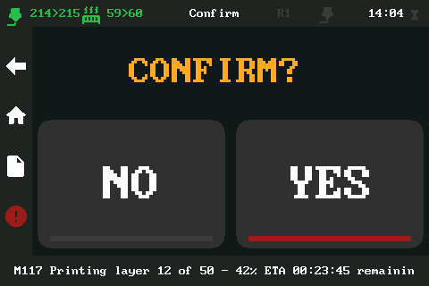<br>**Power** — emergency stop, restart, host shutdown |
| 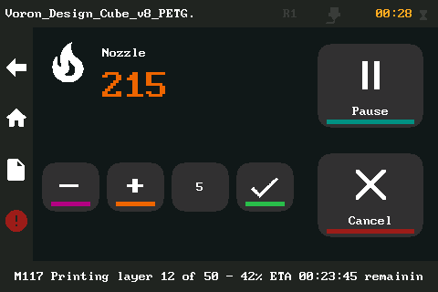<br>**Adjust popup** — −, +, step toggle and save | <br>**Boot splash** — the Mingda mark, drawn by the board |
| 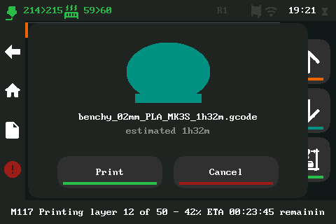<br>**Files** — part preview, estimated time, print or cancel | 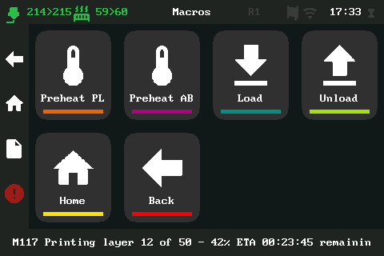<br>**Macros** — your own buttons from a JSON file |
| 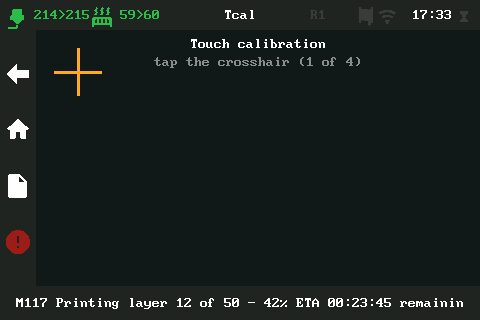<br>**Touch** — 4-point calibration wizard | 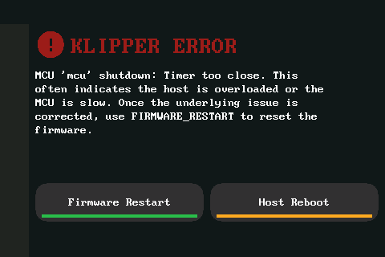<br>**Klipper error** — the reason, then restart right there |

---

## 1. Shopping list

| Item | Notes |
|---|---|
| **Raspberry Pi** | Zero 2 W is enough (this build uses one). Any Pi 3/4/5 also works. |
| **microSD for the Pi** | 8 GB+ |
| **DC-DC step-down 24 V → 5 V, ≥ 2 A** | Powers the Pi from the printer's power supply |
| **3 jumper wires** | For the serial link (female-female, ~15 cm) |
| **SD card the printer already uses** | You will flash the printer board with it |

Tools: a small screwdriver, a multimeter is nice but not required.

---

## 2. Prepare the Raspberry Pi

1. Install **Raspberry Pi OS Lite (64-bit)** with *Raspberry Pi Imager*.
   In the Imager's advanced options set the hostname (e.g. `max`), the user
   (e.g. `mingda`), the Wi-Fi and **enable SSH**.
2. Boot the Pi, connect over SSH:
   ```bash
   ssh mingda@max.local
   ```
3. Install **Klipper + Moonraker + Mainsail** with
   [KIAUH](https://github.com/dw-0/kiauh):
   ```bash
   sudo apt update && sudo apt install -y git
   git clone https://github.com/dw-0/kiauh.git
   ./kiauh/kiauh.sh
   ```
   In KIAUH: **1) Install → Klipper**, then **Moonraker**, then **Mainsail**.
4. Enable the Pi's serial port (needed for the printer link) — edit
   `/boot/firmware/config.txt` and add at the end:
   ```
   enable_uart=1
   dtoverlay=disable-bt
   ```
   then:
   ```bash
   sudo systemctl disable hciuart 2>/dev/null
   sudo reboot
   ```
   After the reboot check it:
   ```bash
   ls -l /dev/serial0      # must point to ttyAMA0
   ```

---

## 3. Install the files from this repository

On your computer, download this repository (green **Code → Download ZIP**, or
`git clone`) and copy the files to the Pi with `scp`. Replace `mingda@max.local`
with your user and host.

**a) Klipper configuration** → `~/printer_data/config/`

```bash
scp printer.cfg macros.cfg moonraker.conf mingda@max.local:~/printer_data/config/
```

**b) The touchscreen driver** → `~/klipper/klippy/extras/display/`
(this is what makes the stock screen work — do not skip it)

```bash
scp mcu/st7796.py mcu/tft_icons.py mcu/tft_thumb.py \
    mingda@max.local:~/klipper/klippy/extras/display/
```

> `~/klipper/klippy/extras/display/` already exists (it is part of Klipper).
> Just copy the three files into it.

---

## 4. Wire everything

You need two connections: **power** for the Pi and the **serial link**.

### 4.1 Power the Pi from the printer PSU

```
      Printer PSU (24 V)
      ┌─────────────────┐
      │   +24V     GND  │
      └───┬──────────┬──┘
          │          │
   ┌──────┴──────────┴──────┐
   │   DC-DC step-down      │
   │      24V → 5V  (≥2 A)  │
   └──────┬──────────┬──────┘
        +5V│          │GND
           │          │
   ┌───────┴──────────┴────────────────┐
   │     Raspberry Pi   5V in    GND   │
   └───────────────────────────────────┘
```

⚠️ Adjust the step-down to **5.0 V with a multimeter before** connecting the Pi.

### 4.2 Serial link (printer board → Pi)

The mainboard has an 8-pin socket (labelled **W1**, meant for an ESP8266
module) that carries the printer's **USART3**:

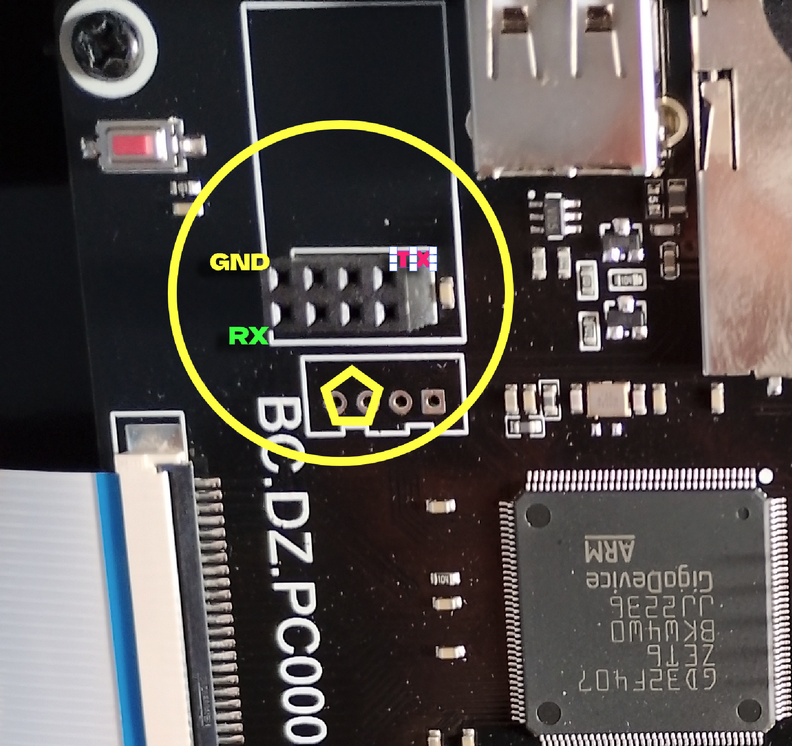

```
        W1 socket (front view)

        ┌─────────────────┐
        │ 1 RX     2 GND  │
        │ 3 EN     4 GPIO2│
        │ 5 RST    6 GPIO0│
        │ 7 3V3    8 TX   │
        └─────────────────┘

   Pi GPIO14 (TX, pin 8)  ───────────────►  pin 8
   Pi GPIO15 (RX, pin 10) ◄───────────────  pin 1
   Pi GND    (GND, pin 6) ────────────────  pin 2
```

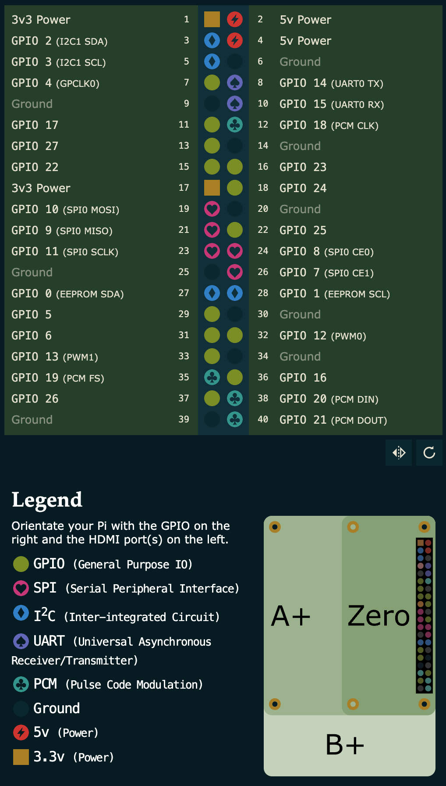

- The socket labels are the **module's** signals, so they are crossed: the
  printer's RX is on **pin 8** and its TX on **pin 1**. If the printer does not
  answer, simply swap pins 1 and 8.
- Connect **nothing else** (especially not pin 7, 3.3 V) and remove any ESP
  module from the socket.
- 3.3 V logic; the grounds are already common through the step-down.

---

## 5. Flash the printer board (SD card)

The printer board is flashed with the same SD-card method the original Marlin
updates used.

1. Copy **`firmware.bin`** (from this repository) to the **root** of the SD card
   the printer uses.
2. Printer **off** → insert that card → power **on**.
3. The screen shows the flashing percentage. At 100 % the bootloader
   **reboots the board by itself** — the new splash appears on the screen.
   (No second power cycle needed.)
4. The Klipper host lost the connection during the flash, so it comes back in
   *shutdown*: open Mainsail and press **Firmware Restart**
   (or, on the panel, ⚠ → **Firmware**). The printer is ready.
5. You can take the card out now.

> Prefer to build the firmware yourself? See [menuconfig.md](menuconfig.md)
> and `build_klipper_fw.sh` at the end of this file.

---

## 6. First start

Power the printer first, then boot the Pi (or restart Klipper from Mainsail).

- Open **Mainsail** at `http://<pi-ip>` — the MCU should come online
  (`/dev/serial0` at 1 000 000 baud) and the printer state should be **Ready**.
- The stock screen shows the splash, then the GUI.

If the panel stays on the splash and the touch does nothing, the board did not
finish flashing — see **Troubleshooting**.

---

## 7. Calibrate once (recommended)

Do this the first time, with the nozzle clean and the bed at temperature.

1. **Z offset** — from the panel: **Main → Z Calibrate**
   (or Mainsail: `PROBE_CALIBRATE`). Move the nozzle down with the on-screen
   buttons until you feel a light drag on a sheet of paper, then **Save**.
2. **Bed mesh** — from the panel: **Main → Level → Start**
   (or Mainsail: `G29`). It heats the bed to 60 °C and the nozzle to 200 °C,
   homes, and probes a 4×4 grid while the panel draws the points; the result is
   saved automatically.
3. **PID** (optional but nice for stable temperatures):
   **More → PID hot** and **More → PID bed**.

Clean the nozzle **before** leveling — the panel reminds you.

---

## 8. Using the touchscreen

Everything is a tap; the left rail is always there
(**back**, **home/main**, **files**, **power/emergency**).

| Screen | How to get there | What it does |
|---|---|---|
| **Printing** | starts automatically during a print | Object preview (from the gcode thumbnail), live values list, pause/resume, cancel. Tap a list row to adjust it on the spot. |
| **Files** | rail 📄 or **Main → Print** | Pick a file (▲/▼ page); ▶ opens a card with the part preview, the name and the estimated time — **Print** or **Cancel** (tap outside also cancels) |
| **Main** | rail 🏠 | Move, Temperature, Extruder, Print, Level, Z Calibrate, More, Home |
| **Move** | Main → Move | Jog X/Y/Z; the bottom strip changes the step size |
| **Temperature** | Main → Temperature | Preheat presets (PLA/PETG/ABS/TPU), cool down, set nozzle/bed |
| **Extruder** | Main → Extruder | Load/unload filament, extrude/retract, nozzle presets |
| **Level** | Main → Level | Bed leveling: it heats, homes and probes, drawing the 4×4 map with a red marker on the point being probed. **Adjust** opens the manual mesh editor; **Cancel/Abort** stops it. |
| **Adjust** | Level → Adjust | Tap a grid point (the nozzle moves there and down to the mesh surface), then nudge with − / + and a 0.005/0.01/0.1 step. **Save** writes it to `printer.cfg`. |
| **Advanced** | Extruder → More… → Advanced | Pressure advance, smooth time, input shaper frequencies — tap a card, adjust, **Save** to keep it |
| **Limits** | More → More… → Limits | Velocity, acceleration, square corner velocity, minimum cruise ratio |
| **More** | Main → More | Save config, filament sensor, network, beep, Info, Telegram, **Macros**, **Touch** |
| **Macros** | More → Macros | Your own buttons, defined in `panel_macros.json` (see below) |
| **Touch** | More → Touch | 4-point touch calibration: tap the crosshairs, then copy the printed values into `printer.cfg` |
| **Klipper error** | appears by itself | If Klipper stops, the panel shows the reason and two buttons: **Firmware Restart** and **Host Reboot** |
| **Power** | rail ⚠ | Emergency stop, Klipper restart, **Firmware restart**, reboot/shutdown the Pi |

Tips

- The top bar shows an **orange arrow** when Moonraker finds updates for
  Klipper or Mainsail; tap it to see how many commits each one is behind.
- The **amount of each adjustment** (the step) is itself a button: tap it to
  cycle 0.1 → 0.5 → 1 → … or 0.005 → 0.01 → 0.1.
- **Pause**, **Cancel** and the rail always work, even mid-print.
- Emergency stop (⚠ → Emergency) needs a **Firmware restart** afterwards.

---

## 9. Troubleshooting

**The panel freezes / the touch does nothing.**
The printer board stopped answering (a reset, a glitch, or a flashing mistake).
Klipper tries to recover by itself; if it does not, **power the printer off and
on**. The panel and Mainsail come back with it.

**"Lost communication with MCU" in Mainsail.**
Same thing — press **Firmware Restart**. If it happens right after a flash, it is
expected.

**The printer does not move / "Must home axis first".**
Press **Home** (Main → Home) first: Klipper refuses to move before homing.

**The screen is white or shows noise.**
The board has no firmware (or an old one). Flash it again with the SD card
(section 5). The panel is initialised by the board itself at power-on, so a
working board always shows at least the splash.

**Nothing answers over serial.**
Swap the two data wires (pins 1 and 8 in section 4.2) and check that
`ls -l /dev/serial0` points to `ttyAMA0`.

**Everything runs but the panel stays on the splash.**
Check that the three files were copied to
`~/klipper/klippy/extras/display/` and restart Klipper.

---

## 10. Repository layout

```
klipper_printer/
├── firmware.bin              printer board firmware (SD flash)
├── printer.cfg               Klipper config (pins, display, touch, mesh)
├── macros.cfg                G28/G29/PAUSE/RESUME, beep, preheat
├── moonraker.conf            adds the Sound switch to Mainsail
├── mcu/
│   ├── st7796.py             host GUI chip (menus, screens, touch)
│   ├── tft_icons.py          icon bitmaps
│   ├── tft_thumb.py          reads the gcode thumbnail (object preview)
│   ├── fsmc_tft.c            MCU driver: FSMC panel + XPT2046 touch
│   ├── splash.h              generated boot splash
│   └── font8x14.h            panel font
├── tools/                    development helpers (simulator, generators)
├── images/                   screenshots used in this guide
├── build_klipper_fw.sh       rebuild firmware.bin
└── menuconfig.md             exact Klipper menuconfig settings
```

Optional extras: `startup_tune.sh` / `shutdown_tune.sh` (Pi boot melodies),
`firmware_250k_backup.bin` (the 250 kbaud build, in case you revert the baud).

---

## 11. Rebuilding the firmware (optional)

Only needed if you change `mcu/fsmc_tft.c`, the font, or the splash.

```bash
# needs an ARM GCC toolchain with newlib (see the script)
cd klipper_printer
./build_klipper_fw.sh        # writes firmware.bin, then flash it (section 5)
```

`tools/make_splash.py` regenerates `mcu/splash.h` from the fonts and icons
(it runs automatically inside the build script).
`tools/tft_sim.py <screen>` renders any GUI screen to a PNG, handy to check a
layout change without touching the printer (needs Python + Pillow).

---

## WiFi and hostname from the panel

`More -> Network` can scan, connect, disconnect, start the emergency hotspot
and rename the printer. The GUI runs as `mingda`, so it calls one small root
helper - install it once:

```bash
sudo install -m 755 tools/klipper-net /usr/local/sbin/klipper-net
echo 'mingda ALL=(root) NOPASSWD: /usr/local/sbin/klipper-net' \
    | sudo tee /etc/sudoers.d/klipper-wifi
sudo chmod 440 /etc/sudoers.d/klipper-wifi
sudo visudo -c          # must say "parsed OK"
```

The keyboard that asks for the WiFi password also edits the hostname
(`a-z`, `0-9`, `-`, up to 63 characters). Passwords are masked on screen and
never written to the Klipper log.

## Custom macro tiles

Any of your macros can have its own big button. Create
`~/printer_data/config/panel_macros.json` (up to 7 entries) and it shows up
under **More → Macros**. The file is re-read whenever it changes — no restart.

```json
[
  {"label": "Preheat PLA", "icon": "heatup", "gcode": "PREHEAT_PLA"},
  {"label": "Load",        "icon": "load",   "gcode": "LOAD_FILAMENT"}
]
```

- `label` — the text on the tile (10 characters max)
- `gcode` — anything you would type in the console (a macro name, `M106 S255`, …)
- `icon` — optional: `alert`, `back`, `bed`, `bedlevel`, `bedmesh`, `check`,
  `cog`, `console`, `cool`, `down`, `edown`, `eup`, `extrude`, `fan`, `files`,
  `fire`, `heat`, `heatup`, `heatwave`, `home`, `info`, `led`, `left`, `limits`,
  `load`, `mesh`, `move`, `network`, `nozzle`, `power`, `print`, `probe`,
  `refresh`, `right`, `save`, `script`, `settings`, `speed`, `thermo`,
  `unload`, `up`, `zoffset` (anything else falls back to `script`)

A ready-to-edit copy is in `tools/panel_macros.example.json`.

---

## Telegram (notifications + commands)

`telegram.sh` sends the notifications (print finished/cancelled/error, filament
runout). `tg_bot.py` is a small bot that also takes commands from the chat.
Both read the token from `~/printer_data/config/telegram.conf` (600, never in
git):

```
TOKEN=123456:ABC...
CHAT=123456789
```

Install the bot once:

```bash
sudo cp tools/klipper-tg-bot.service /etc/systemd/system/
sudo systemctl daemon-reload
sudo systemctl enable --now klipper-tg-bot
```

Commands (also shown in Telegram's "/" menu): `/status`, `/pause`, `/resume`,
`/cancel`, `/home`, `/files`, `/print <name>`, `/unload` (pause + eject),
`/load` (insert), `/beep`, `/ip`, `/host`, `/help`.

## Hardware notes

- **Host:** Raspberry Pi Zero 2 W, powered from the printer's 5 V rail and
  wired to the board over UART (GPIO14/15 -> USART3, 1 Mbaud). Keep those
  three wires (TX, RX, GND) short - twisted with GND - and away from the
  stepper cables.
- **Where it lives:** moved out of the chassis into the printer's tool box,
  so the SD card and the USB ports can be reached without opening the
  printer.
- **If the WiFi drops:** on the panel use the alert icon -> *Reboot* (it goes
  through the local Moonraker, no network needed). When the Pi is within
  reach check `vcgencmd get_throttled` (`0x0` = no undervoltage) and
  `dmesg | grep -i wlan`; a weak 5 V supply is the usual cause. Turning the
  WiFi powersave off (`wifi.powersave = 2` in `/etc/NetworkManager/conf.d/`)
  also helps.
- **SD card:** keep a backup image; the host files live in
  `~/klipper/klippy/extras/display/` (`st7796.py`, `tft_icons.py`,
  `tft_thumb.py`).

## Licence

**GPL-3.0-or-later** (c) 2026 peekpt.

The MCU driver (`fsmc_tft.c`) and the host chip (`st7796.py`) are built on
[Klipper](https://www.klipper3d.org/) (GPLv3, (c) Kevin O'Connor and
contributors), so they follow the same licence.
Icons: Material Design Icons (c) Pictogrammers, Apache-2.0; the printer and
sensor icons are original artwork for this project.
